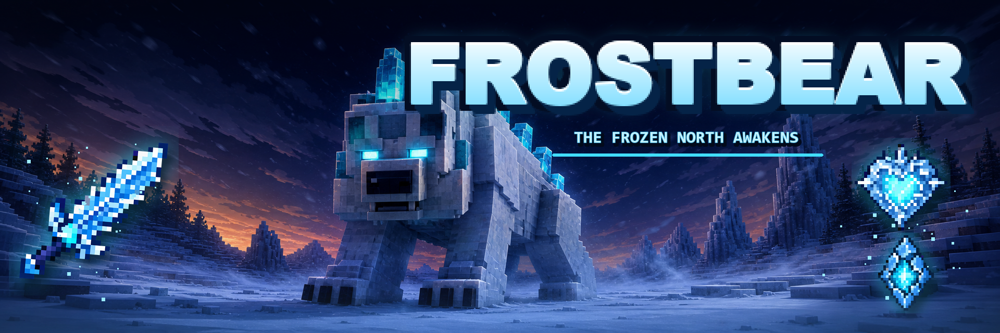

# FrostBear



FrostBear is a Fabric and NeoForge mod for Minecraft Java Edition 26.2 that adds a powerful frozen polar-bear boss, new combat encounters, custom loot, and an ice-spike weapon.

## Highlights

- A 260-health FrostBear boss with a boss bar, glowing eyes, custom sounds, and heavy knockback resistance.
- Roar, frost breath, charging, chilling melee attacks, and ground-based ice-spike waves.
- Natural encounters in snowy and icy biomes.
- A dedicated FrostBear guardian near igloos.
- Polar bears transform into FrostBears when affected by both Slowness and Weakness.
- A custom model with a reworked head, visible jaw, connected back crystals, and dedicated animations.

## Rewards

### Frozen Heart

Right-click for instant Heart of Winter activation—there is no eating animation. The effect grants freeze immunity, slows and freezes nearby hostile mobs, and provides a short regeneration burst.

### Glacial Core

A FrostBear crafting material used to create and repair Frostfang.

### Frostfang

A diamond-tier sword that chills enemies. Right-click to erupt a forward wave of ice spikes, followed by a six-second cooldown.

Crafting recipe:

```text
Glacial Core
Blue Ice
Stick
```

## Requirements

| Component | Fabric | NeoForge |
| --- | --- | --- |
| Minecraft Java Edition | 26.2 | 26.2 |
| Loader | Fabric Loader 0.19.3 or newer | NeoForge 26.2.0.90 or newer |
| Fabric API | Required | — |
| Java | 25 | 25 |

The mod runs on both integrated and dedicated servers. Clients connecting to a modded server also need FrostBear (and Fabric API on Fabric) installed.

## Installation

1. Install Fabric Loader (plus Fabric API) or NeoForge for Minecraft 26.2.
2. Download the matching JAR from the GitHub Releases page, Modrinth, or CurseForge:
   - Fabric: `frostbear-fabric-26.2-1.1.0.jar`
   - NeoForge: `frostbear-neoforge-26.2-1.1.0.jar`
3. Place the JAR in the profile's `mods` directory.
4. Start Minecraft with the corresponding profile.

## Finding the FrostBear

- Search snowy and icy biomes for natural spawns.
- Explore igloos for a guardian encounter.
- Apply both Slowness and Weakness to a polar bear.
- Use the creative-mode spawn egg.
- Run `/summon frostbear:frost_bear ~ ~ ~`.

Useful command:

```mcfunction
/give @s frostbear:frost_bear_spawn_egg
```

## Screenshots

Release screenshots belong in [`screenshots/`](screenshots/). The folder contains the recommended filenames and capture guidelines.

## Project layout

One Gradle build produces both loader JARs:

| Module | Contents |
| --- | --- |
| `common` | All gameplay, models, rendering, mixins, and assets. Compiled against vanilla Minecraft only. |
| `fabric` | Fabric entrypoints, registration, events, and `fabric.mod.json`. |
| `neoforge` | NeoForge entrypoint, registration, events, `neoforge.mods.toml`, and the biome modifier. |

Common code registers objects through `FrostBearPlatform`; each loader module supplies its own implementation. Put new content in `common` and only touch the loader modules for loader-specific hooks.

## Building from source

Install JDK 25, clone the repository, and run:

```powershell
.\gradlew.bat build
```

On macOS or Linux:

```bash
./gradlew build
```

The distributable JARs are generated at:

```text
fabric/build/libs/frostbear-fabric-26.2-1.1.0.jar
neoforge/build/libs/frostbear-neoforge-26.2-1.1.0.jar
```

Launch an isolated development client or server with:

```powershell
.\gradlew.bat :fabric:runClient
.\gradlew.bat :neoforge:runClient
.\gradlew.bat :fabric:runServer
.\gradlew.bat :neoforge:runServer
```

## Development model portal

The model portal is maintained as a separate local development tool and is not part of the published mod source tree. The Java model and production textures used by Minecraft are under `common/src/main`.

## License

FrostBear is available under the [MIT License](LICENSE).
